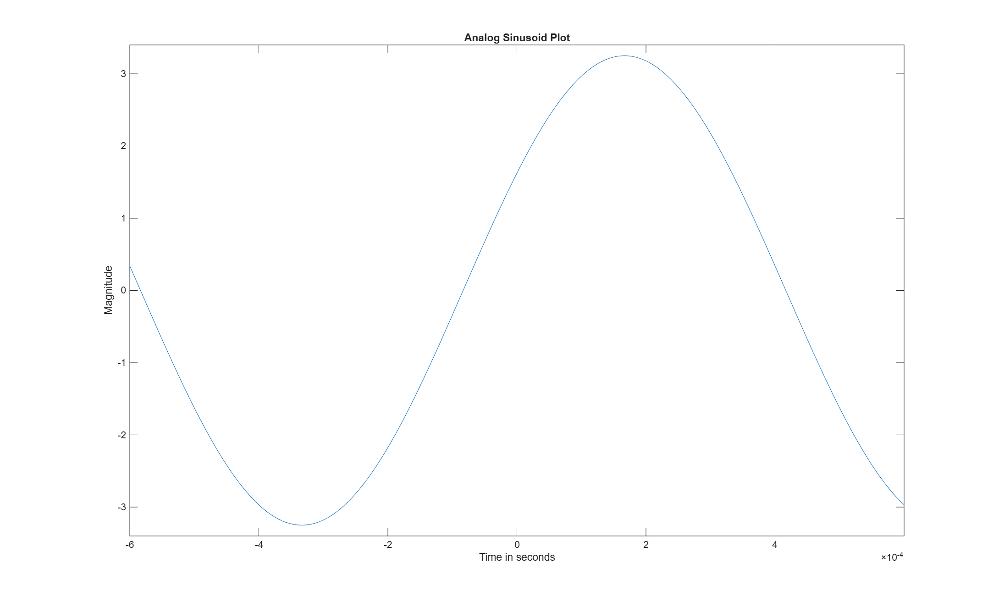
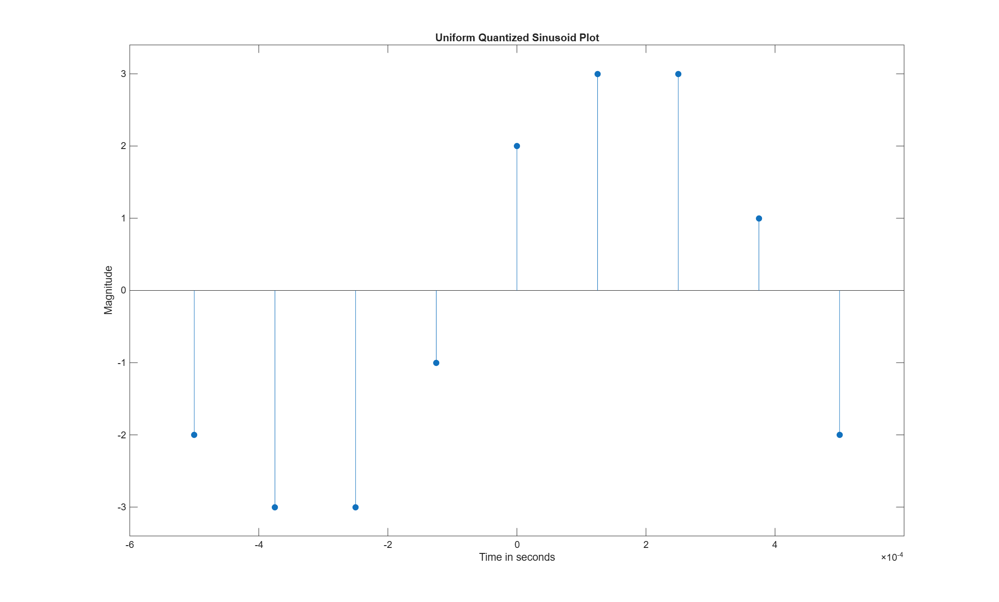
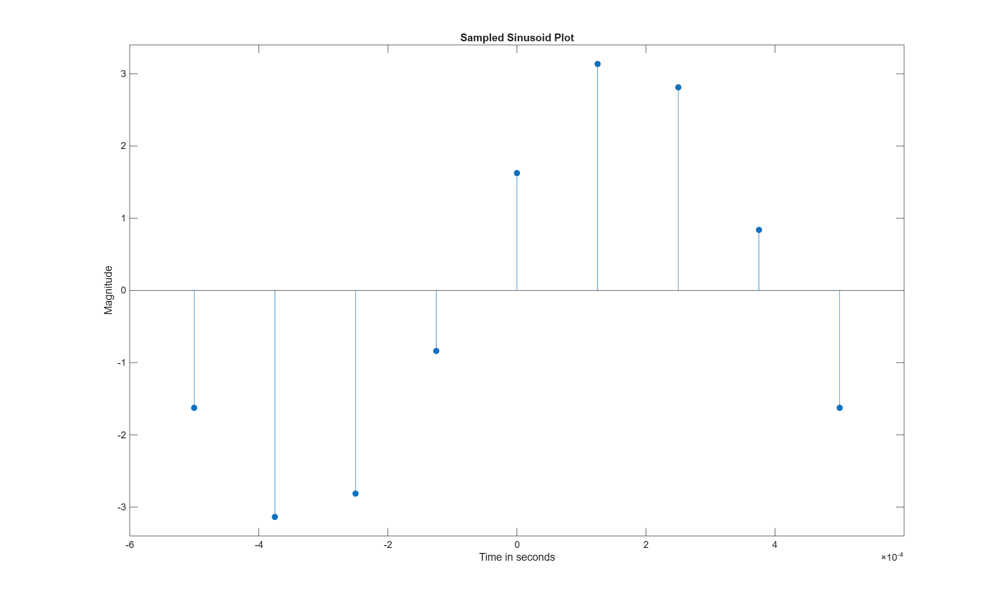
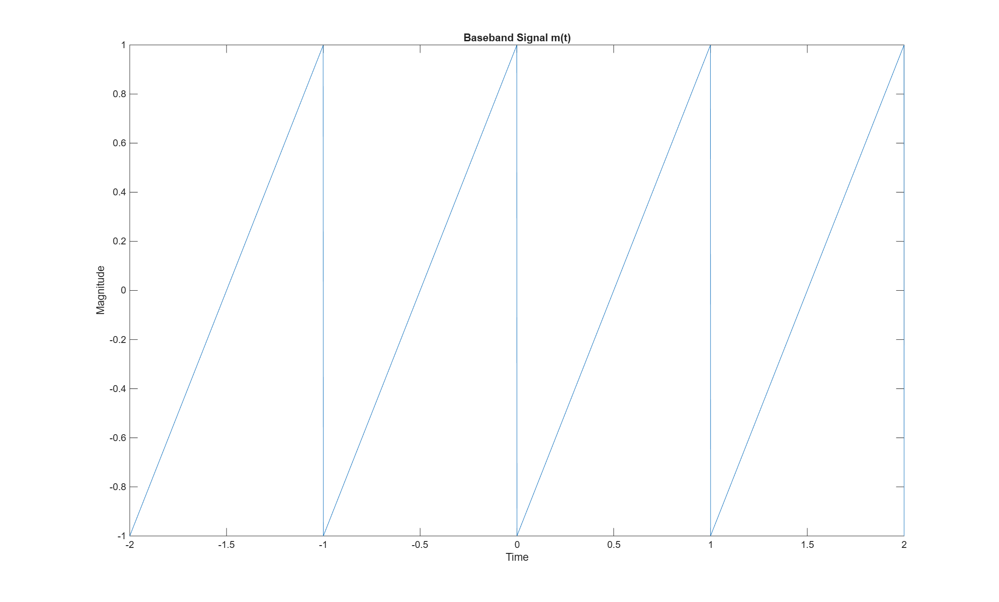
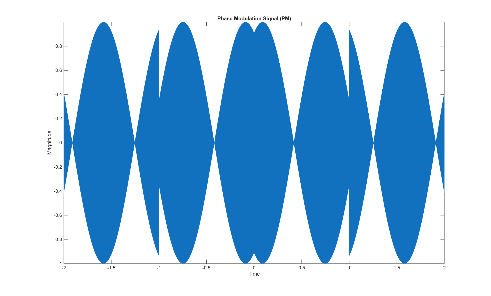
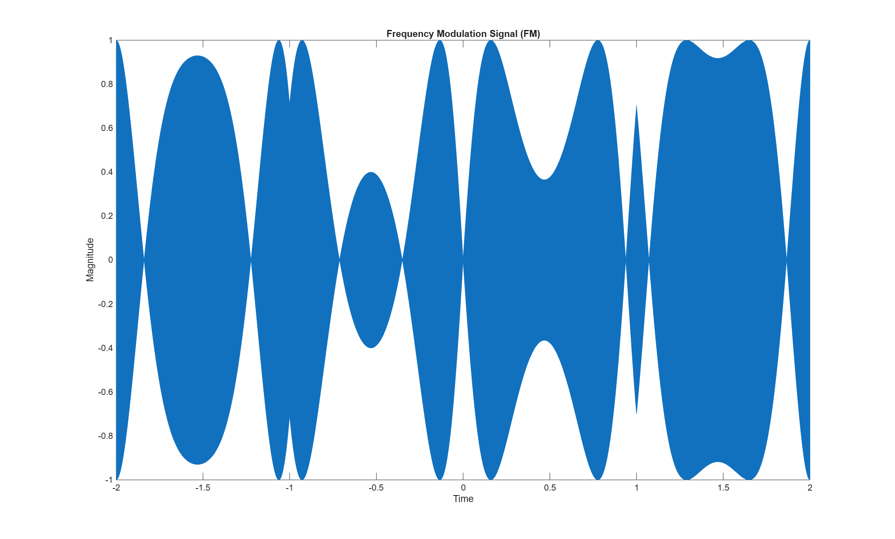

# Digital Communications & Signal Processing (MATLAB)

## Overview
This repository contains MATLAB implementations of core digital communications and signal processing concepts, focusing on continuous to discrete signal conversion (sampling, uniform quantization, and midrise quantization) and analog angle modulation schemes (Phase Modulation and Frequency Modulation).

---

## 1. Sampling & Quantization

### Theory & Parameters
* **Input Signal:** Continuous sinusoid with A = 3.25 V, f = 1000 Hz, and phi = pi/6 rad.
* **Sampling Rate:** Sampled at 4x Nyquist Rate (fs = 8000 Hz).
* **Quantization Schemes:** Evaluates discrete levels under both Uniform Quantizer (range: -3V to +3V) and Midrise Quantizer (range: -3.5V to +3.5V).

### Results & Figures

| Analog Input vs. Sampled Output | Uniform vs. Midrise Quantization |
| :---: | :---: |
|  |  |
|  |  |

---

## 2. Analog Modulation (PM & FM)

### Theory & Parameters
* **Baseband Signal:** Sawtooth waveform (A = 1, T0 = 1 s).
* **Phase Modulation (PM):** Phase sensitivity kp = 2, carrier frequency fc = 1000 Hz. Demonstrates instantaneous phase shifts corresponding to baseband amplitude drops.
* **Frequency Modulation (FM):** Frequency sensitivity kf = 2, carrier frequency fc = 1000 Hz. Implemented via discrete integration (`cumsum`). Demonstrates frequency variation directly proportional to message amplitude.

### Results & Figures

